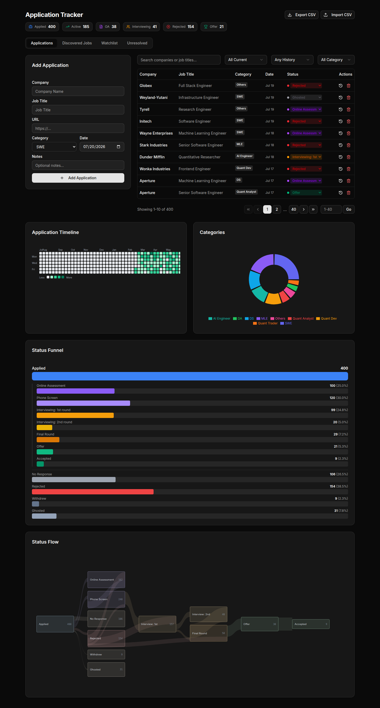

# Job Matchbook

**Your job sources, evidence and application history — available to ChatGPT.**

[](https://github.com/drink970082/job-matchbook/actions/workflows/ci.yml)
[](./LICENSE)

Job Matchbook collects jobs from official company boards, stores their descriptions,
and tracks applications in a self-hosted SQLite database. Its read-only MCP tools let
ChatGPT inspect jobs and application history for personal analysis and a Daily Job Brief.
Screening and résumé-fit scoring remain available as **optional assistance**. Fit
pre-ranking is a last-priority option for a demonstrated volume bottleneck; if scheduled
ChatGPT handles the workload, no fit rollout is needed.

> **Collect and preserve job evidence → query with ChatGPT → review and apply by hand → track.**

ChatGPT-led judgment and delivery are the product direction, not a claim that every
roadmap feature is implemented. The current web Discovered Jobs view still uses fit
buckets; an unscored job or standalone screen is not necessarily visible in Matched.
See the [feature readiness matrix](docs/ROADMAP.md#feature-ownership-and-readiness).

<p align="center">
  
</p>

## What is available

- **Discover:** scheduled watchlists and public discovery feeds, official-board JD
  retrieval, generic HTTP/browser recipes and unresolved-source records.
- **Read with ChatGPT:** ten bounded read-only MCP tools covering postings, full JD
  chunks, standalone screenings, applications/history and the other ATS record types.
- **Track:** manual application entry, Mark Applied, status history, CSV import/export,
  KPIs and charts; a web-managed watchlist.
- **Assist optionally:** standalone hard-requirement screening, the existing résumé-fit
  scorer and Telegram alerts. The operator currently uses Codex Luna/medium screen-only;
  fit and Telegram are bypassed in that mode. Combined scoring remains the CLI default.

A ChatGPT task must be configured and tested separately for unattended daily delivery.
MCP is currently read-only: it cannot import web jobs, record Brief delivery, save an
agent assessment or update applications. Context-based cross-day deduplication is
best-effort until a persistent delivery ledger exists.

No auto-apply, no public multi-tenant service and no CAPTCHA workarounds. Private
configuration, résumé files and databases are gitignored. Optional fit scoring sends
selected JD and personal inputs to the configured provider; connecting ChatGPT exposes
the data returned by the enabled MCP tools to that chat.

## Quick start

**Tracker only** — no worker or model required:

```bash
make install && make db-push && make dev     # http://localhost:3000
```

**Discovery and optional assistance** — native Python worker plus web app:

```bash
make setup     # dependencies, DB and non-clobbering private config templates
make doctor    # inspect prerequisites for the selected path
make up        # web app in Docker; does not start the native worker
cd apps/worker
python -m ats_worker.run --fetch-only --once
```

Fetch-only does not call the screen or fit model, but still uses configured intake
filters and the existing expiry/retry flow. It does not yet implement the target
unscored-inventory UI or freshness improvements.

To opt into standalone subscription-backed screening:

```bash
python -m ats_worker.run --screen-only --screen-backend codex \
  --screen-model gpt-5.6-luna --screen-effort medium --screen-limit 40 --once
```

Run `codex login` on the host first. `--screen-unlimited` is an explicit alternative to
`--screen-limit`, not unlimited subscription entitlement. Screening is distinct from fit;
this command does not enable Luna fit scoring. Running without a mode flag selects the
existing combined pipeline and may invoke fit scoring and Telegram. Read
[SETUP](docs/SETUP.md) before selecting it or enabling a metered provider.

## Sources and components

11 platform adapters: Greenhouse, Lever, Ashby, Workday, SmartRecruiters, Workable,
Pinpoint, iCIMS, Phenom, Oracle and Jobvite; plus custom HTTP and browser recipes.
Oracle/Jobvite resolve feed listings rather than per-company watchlist rows.

Next.js 14 / React 18 / Prisma 6 / SQLite web app; Python 3.11 native worker;
stdio MCP through a private tunnel; Docker Compose for web/autoheal.
See [current and target architecture](docs/ARCHITECTURE.md) and the detailed
[implementation specification](docs/SPEC.md).

## Documentation

| Document | Purpose |
|---|---|
| [Architecture](docs/ARCHITECTURE.md) | Current implementation, target ownership and boundaries |
| [Roadmap](docs/ROADMAP.md) | Feature readiness, R1–R4 priorities and acceptance |
| [Pivot decision](docs/superpowers/specs/2026-10-22-chatgpt-first-pivot-design.md) | Approved ChatGPT-primary direction with optional scorer retained |
| [Setup](docs/SETUP.md) | Tracker, discovery, optional screen/scorer and MCP paths |
| [Spec](docs/SPEC.md) | Shipped capabilities, contracts, data model and operational reference |
| [Progress](docs/PROGRESS.md) | Branch claims, next work and current limitations |
| [Backlog](docs/BACKLOG.md) | Current triage; links to deferred technical investigations |
| [Evaluation](docs/EVALUATION.md) | Relevant checks, retained eval tools and private corpus limitations |
| [Scoring reference](docs/SCORING.md) | Optional subsystem contracts and measured failure modes |
| [Principles](docs/PRINCIPLES.md) / [Development](docs/DEVELOPMENT.md) | Design and contribution protocol |
| [Rejected proposals](docs/REJECTED.md) | Negative findings to consult before redesign |
| [Contributing](CONTRIBUTING.md) / [Security](SECURITY.md) | Tests, conventions and accepted-risk scope |
| [Changelog](CHANGELOG.md) | Release history |

[MIT license](LICENSE) · [Code of conduct](CODE_OF_CONDUCT.md)
