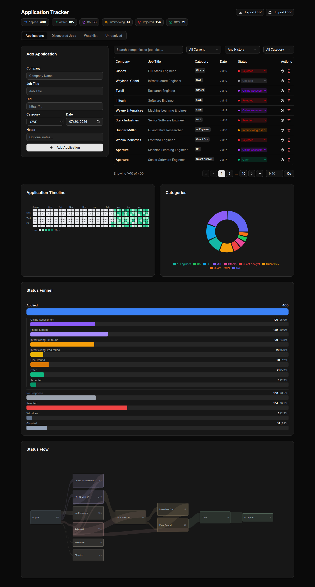

# Job Matchbook

**Your job sources, evidence and application history — available to your AI assistant.**

[](https://github.com/drink970082/job-matchbook/actions/workflows/ci.yml)
[](./LICENSE)

Job Matchbook collects jobs from official company boards, stores their descriptions,
and tracks applications in a self-hosted SQLite database. Its MCP tools let an AI
assistant such as ChatGPT inspect jobs and application history for personal analysis and
a Daily Job Brief. Hard-requirements screening and a JEV keep/skip filter are available
as **optional assistance**.

> **Collect and preserve job evidence → query with your AI assistant → review and apply by hand → track.**

AI-led judgment and delivery are the product direction, not a claim that every roadmap
feature is implemented; see the [feature readiness matrix](docs/ROADMAP.md#feature-readiness).

<p align="center">
  
</p>

## What is available

- **Discover:** scheduled watchlists and public discovery feeds, official-board JD
  retrieval, generic HTTP/browser recipes and unresolved-source records.
- **Work through your assistant (MCP):** bounded read tools for postings, full JD chunks,
  screenings, applications/history, the watchlist and settings; with a write key, tools
  to log applications, update status/notes, override keep/skip, manage the watchlist and
  set preferences and the JEV profile. Works with ChatGPT (via a tunnel), Claude Code or Codex.
- **Track:** manual application entry, Mark Applied, status history, CSV import/export,
  KPIs and charts; the web shows the watchlist and activity read-only.
- **Assist optionally:** hard-requirement screening (local Ollama by default, or a
  CLI/API backend) and the JEV keep/skip filter (metered OpenRouter by default, or
  through the screen backend).
- **Write API:** a key-scoped loopback `/api/v1` that the MCP write tools call, off
  until a key is set.

A scheduled assistant task must be configured and tested separately for unattended daily
delivery. Without `ATS_API_KEY` the MCP server is read-only. Cross-day deduplication is best-effort until a
persistent delivery ledger exists.

No auto-apply, no public multi-tenant service and no CAPTCHA workarounds. Private
configuration, résumé files and databases are gitignored. A hosted screen backend
receives JD text and your hard requirements, the JEV filter sends JD text and your
private `jev_dir` profile to OpenRouter (or the screen backend), and connecting an assistant exposes
the data returned by the enabled MCP tools to that chat.

## Quick start

**Tracker only** — no worker or model required:

```bash
make install && make db-push && make dev     # http://localhost:3000
```

**Discovery and optional assistance** — native Python worker plus web app:

```bash
make setup     # dependencies, DB and non-clobbering private config templates
make doctor    # inspect prerequisites for the selected path
make up        # web app in Docker; does not start the native worker
cd apps/worker
python -m ats_worker.run --fetch-only --once
```

Fetch-only calls no model, but still uses configured intake filters and the existing
expiry/retry flow.

To opt into standalone subscription-backed screening:

```bash
python -m ats_worker.run --screen-only --screen-backend codex \
  --screen-model gpt-5.6-luna --screen-effort medium --screen-limit 40 --once
```

Run `codex login` on the host first. `--screen-unlimited` is an explicit alternative to
`--screen-limit`, not unlimited subscription entitlement. Read [SETUP](docs/SETUP.md)
before enabling a metered provider or the JEV filter (`--jev`).

**Connect your assistant:** [SETUP Path D](docs/SETUP.md#path-d--ai-assistant-access-mcp)
installs the MCP server and connects Claude Code, Codex or ChatGPT; then
[DAILY_BRIEF](docs/DAILY_BRIEF.md) sets up a scheduled daily brief.

## Sources and components

11 platform adapters: Greenhouse, Lever, Ashby, Workday, SmartRecruiters, Workable,
Pinpoint, iCIMS, Phenom, Oracle and Jobvite; plus custom HTTP and browser recipes.
Oracle/Jobvite resolve feed listings rather than per-company watchlist rows.

Next.js 14 / React 18 / Prisma 6 / SQLite web app; Python 3.11 native worker;
stdio MCP through a private tunnel; Docker Compose for web/autoheal.
See [current and target architecture](docs/ARCHITECTURE.md) and the detailed
[implementation specification](docs/SPEC.md).

## Documentation

**Using it**

| Document | Purpose |
|---|---|
| [Setup](docs/SETUP.md) | Tracker, discovery, optional screen/JEV, connecting an assistant (MCP) and the write API |
| [Daily Brief](docs/DAILY_BRIEF.md) | Prompt template and checklist for a scheduled daily job brief |
| [Security](SECURITY.md) | Accepted-risk scope and reporting |

**Contributing**

| Document | Purpose |
|---|---|
| [Contributing](CONTRIBUTING.md) | Tests, conventions, branching and releases |
| [Development](docs/DEVELOPMENT.md) | Session protocol: task types, verify gate, definition of done |
| [Principles](docs/PRINCIPLES.md) | Design rules for forks |
| [Changelog](CHANGELOG.md) | Release history |

**Project internals**

| Document | Purpose |
|---|---|
| [Spec](docs/SPEC.md) | Shipped capabilities, contracts, data model and operational reference |
| [Architecture](docs/ARCHITECTURE.md) | Ownership boundary and current implementation |
| [Roadmap](docs/ROADMAP.md) | Feature readiness and delivery order |
| [Progress](docs/PROGRESS.md) | Branch claims, next work and current limitations |
| [Backlog](docs/BACKLOG.md) / [Rejected](docs/REJECTED.md) | Unselected work; negative findings to consult before a redesign |
| [Evaluation](docs/EVALUATION.md) / [Scoring](docs/SCORING.md) | Which checks apply; screen contracts and measured failure modes |

[MIT license](LICENSE) · [Code of conduct](CODE_OF_CONDUCT.md)
