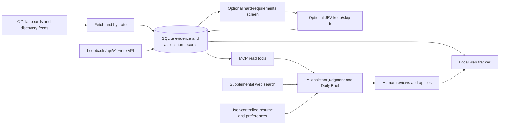

# Architecture — ATS tools with AI-assistant judgment

**Status:** the ownership boundary. [SPEC](SPEC.md) describes shipped behavior in
detail; [ROADMAP](ROADMAP.md) holds the order of unfinished work. The
[pivot decision](superpowers/specs/2026-10-22-chatgpt-first-pivot-design.md) set the
ChatGPT-first split; epic #152 extends it so the AI assistant orchestrates through MCP.

## Responsibilities

| Concern | Job Matchbook | AI assistant (ChatGPT / Daily Job Brief) |
|---|---|---|
| Discovery | Scheduled board/feed collection, official URLs, full JD storage | Supplemental web discovery outside the watchlist |
| Evidence | Posting identity, source text, timestamps, availability and data quality | Read evidence; verify official pages before recommending |
| Judgment | Optional hard-requirements screen; optional JEV keep/skip filter | Eligibility interpretation, fit, career value and final ranking |
| Personal context | Hard requirements in `config.yaml`; JEV reads the private `jev_dir` inputs | Résumé, background, preferences and recommendation rubric |
| Delivery | None from the worker; service health stays local | Daily recommendation and notification workflow |
| Tracking | Applications, status history, watchlist, backups | Consult application history |

## Current implementation

- Next.js/Prisma web app and native Python worker share SQLite with WAL. Prisma owns DDL.
- A worker pass is fetch -> screen, plus the JEV keep/skip filter when `--jev` is set
  (paid OpenRouter calls, capped by `--jev-limit` / `--jev-max-usd`; needs `jev_dir` and
  `OPENROUTER_API_KEY`). There is no fit scorer and no Telegram stage.
- `job_screenings` and `job_jev_assessments` are separate from `pipeline_status`. A
  `new` posting can carry a completed disqualification or a JEV verdict. Missing facts and
  provider errors are not evidence of eligibility.
- MCP exposes ten bounded, read-only tools and full text in chunks. `list_jobs` hides a
  current JEV `skip` on a still-`new` posting by default.
- The web exposes a key-scoped loopback write API at `/api/v1` (bearer keys
  `ATS_API_KEY_READ_WRITE` / `ATS_API_KEY_READ`; no key configured = `503`) over the
  same server actions the UI uses; rows it writes carry `actor`, shown as "via MCP" in
  the web. The MCP application write tools (#154) and workflow prompts (#159) call it; a
  web dashboard that is read-only except Applications and Settings (#158) and the rest of
epic #152 are planned.

## Boundaries

**Evidence vs. judgment.** Raw JD and official identity are kept independently of model
assessments. Query eligibility must not depend on a model verdict: a JEV `skip` is hidden
by default, never deleted, and stays listable. Fetch-time candidate/title filters run
before any model sees a posting, so changing the screen does not restore jobs excluded
during intake.

**Optional assistance.** The screen and JEV are bounded assistants, not the product's
judgment. Subscription or metered inference consumes allowance; no zero-cost guarantee is
made. Changing a model, effort or rubric needs a scoped evaluation ([EVALUATION](EVALUATION.md)).

**Freshness.** Conflict handling does not generally update stored JDs, and the expiry
recheck selects only `scored`/`notified` rows, so a stored `new` posting is not proof the
requisition is still open.

**Personal context.** Durable task instructions or an accessible profile document define
current preferences; conversational memory alone is not a versioned configuration. No
private résumé or settings belong in public documentation.

**Delivery and durable state.** A chat does not wake on database changes. A configured
scheduled task can provide a daily brief, subject to product availability and unattended
MCP access. The worker also starts a pass at 20:00 America/New_York, so a 20:00 brief must
disclose its data cutoff. There is no persistent recommendation-delivery ledger (#95).
Application history is the source of truth even when postings lack application links.

## Extension seams

Use the existing fetch adapters/recipes, repository queries and dependency-injected
worker modules. Prefer literal search and SQL filters before a vector database. Write
paths record `actor` (`web` / `mcp`) for provenance. Operational health alerts stay
distinct from job recommendations.
