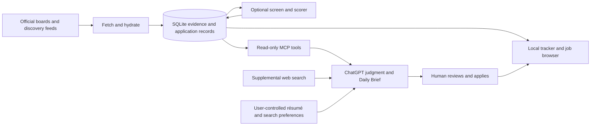

# Architecture — ATS tools with ChatGPT judgment

**Status:** approved product direction; the implementation boundary is explicit below.
The [pivot decision](superpowers/specs/2026-10-22-chatgpt-first-pivot-design.md)
sets ownership. [SPEC](SPEC.md) describes shipped behavior;
[ROADMAP](ROADMAP.md) contains work required to reach the target.

## Responsibilities

| Concern | Job Matchbook | ChatGPT / Daily Job Brief |
|---|---|---|
| Discovery | Scheduled board/feed collection, official URLs, full JD storage | Supplemental web discovery outside the watchlist |
| Evidence | Posting identity, source text, timestamps, availability and data quality | Read evidence; verify official pages before recommending |
| Judgment | Optional screen/scorer assistance, separately identified | Primary eligibility interpretation, fit, career value and final ranking |
| Personal context | Existing private inputs remain supported for optional scoring | Primary résumé, background, preferences and recommendation rubric |
| Delivery | Existing Telegram path remains supported; service health stays local | Preferred daily recommendation and notification workflow |
| Tracking | Applications, status history, watchlist, backups and manual UI | Consult application history and distinguish possible duplicates |

The diagram expresses ownership, not a new runtime or an automatic database write
from ChatGPT. Read-only MCP cannot save recommendations, import jobs or change status.
The UI remains the manual persistence path.

## Shipped implementation

- Next.js/Prisma web app and native Python worker share SQLite with WAL. Prisma owns DDL.
- Fetch, hydration, feed resolution, coarse intake filters and application tracking exist.
- The operator-selected worker runs fetch/feed/expiry followed by standalone Codex
  `gpt-5.6-luna`, medium effort screening, one worker and explicit unlimited call count.
  Completed results are cached; provider circuit breaking remains. This is **screening**,
  not a Luna fit-scoring deployment.
- The combined screen/fit/Telegram pipeline remains the CLI default. The operator's
  screen-only mode bypasses fit and Telegram; this documentation does not change defaults.
- `job_screenings` is separate from fit `score_detail` and `pipeline_status`. A `new`
  posting can have a completed disqualification. Missing facts and provider errors are
  not evidence of eligibility.
- MCP exposes ten bounded, read-only tools and full text in chunks through the private
  tunnel. The local UI still organizes jobs into fit-oriented buckets.

## Target boundaries and implementation gaps

**Evidence vs. judgment.** Retain raw JD and official identity independently of model
assessments. Query eligibility must not depend on having a score. Existing fetch-time
candidate/title filtering must be inventoried before moving preferences to ChatGPT;
changing the scorer alone does not restore jobs excluded during intake.

**Optional assistance.** Keep both screening and fit-scoring capabilities. Fit pre-ranking
is the last optional step, selected only if actual scheduled ChatGPT retrieval/judgment
cannot handle the relevant volume. Successful scheduled handling can make it unnecessary;
retention of code is not a commitment to run it. Luna/medium
is the preferred low-cost assistance direction because the operator already pays for a
ChatGPT subscription (approximately US$20/month in the operator's context). Subscription
inference still consumes allowance; no unlimited or zero-cost-per-request guarantee is
made. The shipped Luna/medium choice is for screen-only. Choosing Luna for fit, removing
existing model guards or changing its rubric requires a separate scoped evaluation.
A machine score must not become the only path by which ChatGPT can discover a job.

**Freshness.** Existing conflict handling does not generally update stored JDs;
expiry checks select scored/notified rows from supported detail sources. A source-first
product needs freshness/availability semantics for unscored `new` rows as well. Until
then, a stored posting is not proof that a requisition is still open.

**Personal context.** ChatGPT's durable task instructions or accessible profile document
should define current preferences and background; conversational memory alone is not a
versioned configuration. Do not remove private scorer inputs while optional fit scoring
still reads them. No private résumé or settings belong in public documentation.

**Incremental research.** Current MCP filters use posting creation/publication dates,
not screen-completion dates. List rows expose completion metadata but not the full screen
verdict. The target adds bounded verdict/time queries, explicit unknowns and queue counts.
Current completion timestamps use the pass's injected clock; a reliable future incremental
feed must account for late commits and use overlapping windows/stable ordering.

**Delivery and durable state.** A normal chat does not wake on database changes.
A configured ChatGPT task can provide a daily brief, subject to product availability,
permissions and successful unattended MCP access. The worker also starts a pass at 20:00
America/New_York, so a 20:00 brief must disclose its data cutoff rather than promise the
new pass is finished. Reliable cross-day recommendation history needs persistent records;
read-only MCP currently has none. Preserve application history as the source of truth even
when postings lack application links.

## Planned implementation sequence

The first two implementation batches are [MCP research queries](superpowers/plans/2026-10-22-batch-1-mcp-research.md)
and [visible inventory](superpowers/plans/2026-10-22-batch-2-job-inventory.md).
A manual research baseline runs alongside them; scheduled acceptance starts once the
queries/UI are usable, while lifecycle work can proceed independently. See ROADMAP for
issue dependencies and DEVELOPMENT for Astra/Sol orchestration versus Luna/max execution.

Target lifecycle design separates source availability, assessment state and user action.
Do not rewrite pipeline_status wholesale in batches 1–2. Content revision/hash and stale
assessment linkage belong to the separately designed source-lifecycle slice. Before it
ships, response time is not evidence freshness and stored jobs need official-page checks.

## Screen and scorer separation

The existing `score/` package mixes active screening and optional legacy fit/research;
its current facade and shared prompt loader eagerly load all prompt families. The
[scorer boundary plan](superpowers/specs/2026-10-26-legacy-scorer-boundary.md) and
[prefactor #116](https://github.com/drink970082/job-matchbook/issues/116) isolate live
screening while retaining explicit legacy compatibility. New preselection owns its
profile, prompts, typed answers, freshness and price accounting; it does not inherit old
fit context, score_detail writes, seniority ordering or corpora. This is a planned seam,
not a claim that code has already moved or that fit compatibility can be deleted.

## Extension seams

Use the existing fetch adapters/recipes, repository queries and dependency-injected
worker modules. Prefer literal search and useful SQL filters before a vector database.
An optional JEV/System One adapter may classify facts or prioritize review after a shadow
evaluation; it is not a committed dependency, a free service or a replacement for full
ChatGPT explanations. Any future write tools require their own design, authorization and
provenance contract. Operational health alerts remain distinct from job recommendations.
