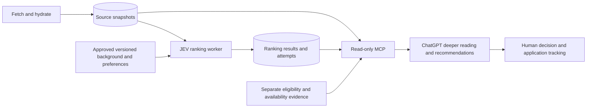

# JEV ranking architecture

**Status:** approved planning baseline, not shipped implementation.
Related: [entry](README.md), [research](research.md), [delivery](delivery.md).

## 1. Product contract

The user needs a useful order in which to examine a daily job inventory. JEV supplies
priority; ChatGPT reads priority and source evidence through MCP and makes deeper career
judgments. Ranking means reading order, not eligibility, probability of hiring or automatic
rejection. Low-ranked, unranked, failed and stale items remain discoverable.

The first slice ranks within domains. It does not construct a cross-domain weighted total.
Retain domain grouping and keep any selected-skill evidence separate. Domain allocation
belongs to the consumer's declared review policy, not hidden backend weights. Existing
screening, application tracking and raw source access remain independently usable.

## 2. Minimal normal path

1. Select a bounded inventory of full-JD snapshots, without requiring a legacy fit score.
2. Bind one snapshot to the approved profile, rubric, question pack and resolved model.
3. Reuse an exact successful cache match, otherwise make one native JEV request carrying
   a fixed small question set. No routine Sol/Haiku extractor, guard or second draw.
4. Validate native values and identity, then deterministically project the ranking result.
5. Persist result and attempt state atomically enough that interrupted completion cannot
   present a fabricated success. Serve the result with source/version/coverage metadata.
6. ChatGPT lists candidates, reads full evidence and gives recommendations.

The target is one request per changed job/input binding, not a claim that all model
capabilities are already proven. Questions use full JD and approved full background as
the initial hypothesis. Test compression only for a demonstrated operational need.

## 3. Logical interface and semantics

`rank(job_snapshot, approved_profile, ranking_policy) -> result | typed_failure`

Callers need not know campaign epochs, shadow stage names or research-controller internals.
HTTP, clock and persistence wiring remain dependency-injected; services wire in run.py.
The actual schema and module placement are a Sol design deliverable before implementation.

A successful result contains:

| Field | Contract |
|---|---|
| job identity and source hash | Binds the answer to the exact stored JD; never attach by list position |
| primary domain | Controlled vocabulary; unknown/mixed supported; approved vocabulary recorded before calls |
| priority | high, medium, low, or null when no defensible tier exists |
| needs_review and reason codes | Independent of priority; no confidence-number threshold invented as semantics |
| rubric dimensions | Small fixed native answer vector needed to explain the projection; no invented quotes |
| provenance | Profile, policy/question, adapter/projection versions and requested/resolved model |
| timestamps | Source revision, assessment completion, attempt timestamps; none implies live availability |
| raw native values | Retained for diagnosis and deterministic re-projection |

Default rubric meaning: high = strong alignment with stated target work and credible
relevance in approved background; medium = plausible alignment or important mixed signals;
low = clearly weaker stated preference alignment, never mere missing résumé evidence.
Unclear duties, uncertain domain or unresolved contradictory signals require review.
Sol must freeze exact question wording, dimension-to-tier mapping and boundary examples
before an experiment. These English definitions are a contract, not a ready prompt.
Missing candidate evidence alone cannot prove inability or automatically force low.

The baseline uses ordinal tiers; no claim of calibrated 0–100 utility. Within each domain,
sort high, medium, low, then publication time descending (missing time last), then stable
job ID. Unknown tier has a separate accessible review lane. A high tier with a review flag
remains high but must expose its uncertainty. Consumer reads deduplicate IDs across lanes.
Probabilities/confidence may be diagnostic, never silently used as tie-break scores.
Multi-domain presentation must not count one posting twice in review budgets.

## 4. Storage and freshness

Keep source, assessment and user action as independent concepts. Do not overload legacy
score_detail, pipeline_status, application status or job_screenings with JEV state.
Prisma owns schema changes; worker issues no DDL. Additive changes first, no cleanup of
historical records as a side effect. Database writes respect existing WAL/thread discipline.

Cache identity includes job/source hash, approved profile hash, question/rubric version,
projection/adapter version and resolved model identity. Changed bindings create new work.
A deployment/version switch must not reuse a semantically incompatible cache entry.

Logical states: pending, running, succeeded, failed, deferred. Freshness is separate:
current, stale, absent. Keep latest successful result and latest attempt independently.
A failed refresh does not erase success; stale success is explicitly labeled and excluded
from current-only ordering by default. Unranked inventory remains queryable.

Use durable attempt identity and bounded work claiming to prevent duplicate dispatch from
concurrent schedulers. A crash after dispatch but before settlement is delivery-unknown,
not zero-cost and not an immediately safe resend. Sol must specify reconciliation and
reclaim behavior. Preserve enough attempt evidence for costs without copying private
profile text into public logs or list responses. Define local retention during the contract
slice; raw artifacts must never be required indefinitely for ordinary MCP reads.

## 5. MCP consumer contract

Prefer extensions to existing tools over a separate platform. Provide:

- Ranked list: domain, tier, review/freshness filters, bounded limit, stable cursor,
  explicit scope/cutoff, ranking version and returned/eligible/assessment-state counts.
- Detail: ranking result, provenance, full JD access, screen result and source availability
  as separate fields. Long text can use existing chunk access; list truncation must be labeled.
- Inventory coverage: counts of current, pending, running, failed, deferred, stale and
  absent assessments; define non-overlapping count categories so totals reconcile.
- Explicit access to low-ranked, unranked and review inventory; absence is not a low tier.

A query pins a result snapshot or equivalent watermark so intervening ranks do not cause
missing/duplicate cursor results. Completion-time incremental retrieval must handle late
commits with stable ordering and overlapping windows or an equivalent reliable strategy.
Do not promise that a source is current merely because ranking ran recently.

ChatGPT first inspects coverage, retrieves a fixed domain allocation, reserves an explicit
review/exploration budget, then opens selected details. It discloses incomplete coverage
and uncertain eligibility. MCP stays read-only; ranking does not create application records,
notifications or durable ChatGPT recommendation history. Scheduled execution is a separate
acceptance surface from an interactive demonstration.

## 6. Resources and failure policy

The 24KB research bound is local, not established provider capacity. At research revision
16deac2, native openrouter_jev.py accepts max_request_bytes (default 20,000); it measures
serialized UTF-8 JSON before HTTP and returns jev_request_too_large/not_sent. Research specs
set 24,000. The comparison chat adapter hardcodes 24,000. Thus the three approximately
25–29KB requests were never evidence of a provider refusal. Bytes are not tokens.

Before choosing production bounds, inspect current official provider limits, measure full
request bytes/tokens over the intended inventory and include overhead/cost. Choose a
configurable conservative ceiling with evidence. Verify larger full requests before
considering splitting. No silent truncation, requirement deletion or automatic generic
composition layer. Claimed model context alone does not establish HTTP limits.

| Failure | Action |
|---|---|
| Opportunity ambiguity | Keep visible; needs_review/unknown, no invented negative fact |
| Wrong identity/schema | Fail loud for the item; never persist success; continue independent items |
| Invalid credentials/model/configuration | Circuit break further dispatch; reads continue |
| Rate limit/transient server failure | Bounded backoff within total attempt/time/spend cap |
| Timeout or delivery/charge unknown | Record uncertainty; reserve conservatively; no immediate unbounded resend |
| Size/context overbound | Visible deferred reason; examine limit before adding architecture |
| Budget exhausted | Stop new dispatch visibly; leave pending queue intact |
| Changed inputs | Mark old success stale; queue new binding |
| Bad new ranking version | Disable new ordering; retain raw inventory and historical result provenance |

Production retry policy is a new explicit contract, not inherited from no-retry experiments.
Every retry counts toward caps. Configuration failures must not consume a per-item loop
across the entire inventory. Rollback must not require restoring an old database backup.

## 7. Reuse and non-goals

| Existing module/asset | Decision |
|---|---|
| jev.py | Candidate for native contract/parser reuse after dependency review |
| openrouter_jev.py | Candidate for protocol/validation reuse; remove shadow coupling only where necessary |
| profile.py | Reuse approved input/version concepts; existing shape is not mandatory architecture |
| preference.py | Rubric evidence, not an automatically accepted production policy |
| preference_guard.py | Research only until a controlled comparison justifies it |
| skills.py | Selected-requirement research; not proof of complete extraction or v1 dependency |
| shadow/convergence/evaluation/replay | Research tools; no mandatory production imports |
| chat/extraction/citations comparator paths | Preserve evidence; not on normal JEV path |
| generic split/composition proposal | Deferred; local byte cap alone is insufficient justification |

No multi-provider scoring platform, automatic apply, cross-domain weighted total, forced
human label campaign, whole-inventory backfill or legacy scorer rewrite. Keep historical
artifacts without polishing every research abstraction. Follow PRINCIPLES 2–7, 9–14:
source facts and model judgments stay distinct; uncertainty remains visible; small modules,
DI, privacy, one schema owner and recorded deferrals constrain implementation.
