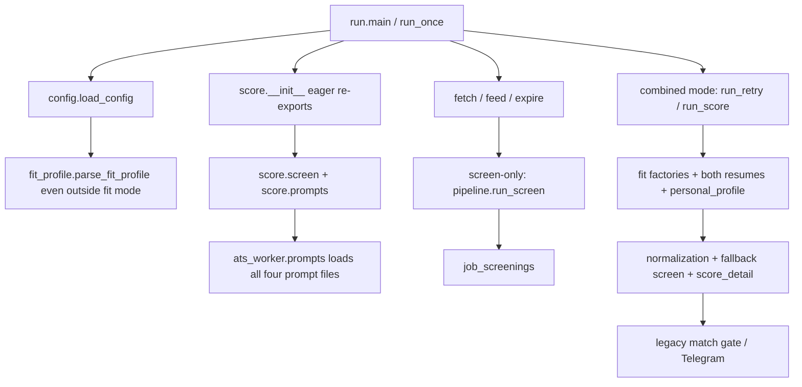

# Legacy scorer inventory and pivot boundary

**Status:** selected separation plan; implementation requires #109's scoped acceptance.
This is an audit and file-ownership contract, not a refactor already shipped. Audited
runtime revision: `670f5969a018a6e0ae6905ed4152d03827f81f7c`.

## What is actually coupled

`score/` is not exclusively a legacy fit subsystem. It holds active standalone screen
logic, fit judgment, adapters, shared prompt builders, quota helpers and deferred research.
Deleting it or importing a convenient submodule both cross more boundaries than expected.

An import-only audit of `ats_worker.run` observed these prompt reads:
`screen.txt`, `score.txt`, `seniority.txt`, `extract.txt`, and loaded 12 `ats_worker.score*`
modules, including all three fit backends. No subprocess or socket call occurred. Python
executes `score/__init__.py` before importing `score.location` or any other child, so a
more specific import alone does not fix the coupling.

Current paths, verified from source:

In screen-only mode, `main` already skips `load_resumes` and `run_once` returns before
fit construction/usage capture/notification. That is execution isolation, not prompt/import
isolation. New work must preserve both. Operational config still supplies screening hard
requirements and intake filters; changing the personal-profile contract does not rewrite
that running configuration.

## Disposition vocabulary

- **Keep active:** currently serves discovery, screening, evidence or tracking.
- **Extract then reuse:** a narrowly specified neutral contract can serve live screening;
  isolate its imports before new work relies on it.
- **Legacy compatibility only:** retained callable behavior/tests for explicit old modes;
  forbidden as new pivot context, output, cache or selection authority.
- **Deferred research only:** retained artifacts/tools, no automatic continuation or import.
- **Retired from the pivot:** no new call path or input dependency. This does not authorize
  deleting compatibility code, private inputs, old DB rows or another branch's research.

## Existing file inventory

Paths below are relative to `apps/worker/` unless stated otherwise.

| Existing file / symbols | Actual responsibility | Disposition and boundary |
|---|---|---|
| `ats_worker/score/__init__.py` | Eager export of screen, fit adapters, schemas, errors and quota APIs | Compatibility shim only; make legacy exports lazy. New code imports neutral screening or new preselection modules, never this facade. |
| `ats_worker/score/screen.py`: `deterministic_screen`, `screen_requires_provider`, `screen_posting`, `_screen_verdict`, degree/auth/clearance helpers, snippet retrieval | Live rule/provider screening used by fetch and standalone `run_screen` | Extract into `ats_worker/screening/`; keep exact live verdict/schema/provider-budget semantics. Sponsorship offers/preference vetoes and clearance evidence floors are not obsolete scoring rules. |
| Same file: `make_ollama_extract`, `_post` | Live injected Ollama screen transport | Extract with the screen backend implementation; preserve current provider behavior and no-network tests. Not a JEV adapter. |
| Same file: `_normalize_score`, `_normalize_assessment`, `_coerce_score`, `_as_str_list` | Old 0-100 fit card and domain/seniority normalization | Legacy only; JEV has independent question/answer validation. No conversion of JEV answers into this card. |
| Same file: `demote_for_confirmation`, `merge_fallback_screen` | Old combined mode removes uncertain degree/clearance verdicts and refills from strong fit response | Legacy only. Never call on standalone screens/JEV, never manufacture a pass from missing new output. Preserve old composition and tests. |
| `ats_worker/score/location.py` | Deterministic country/state/city resolution and unknown handling | Extract then reuse as neutral screening location logic; keep US ambiguity/unknown behavior and fixtures. No LLM replacement or new title blacklist. |
| `ats_worker/score/prompts.py`: `SCREEN_SCHEMA`, `_candidate_block` | Live screen fact schema/checklist | Extract to screen-only prompt/schema module; current schema bytes/meaning and snippet indexing remain compatible. New YOE schema is separate, not inserted during this prefactor. |
| Same file: `_job_block`, `_truncate` | Shared job rendering; location optional; character truncation with marker | Screen-compatible rendering stays with screening; legacy fit retains its own wrapper. New JEV renderer uses full JD/input-completeness checks and must not inherit either truncation or location omission. |
| Same file: `_SCORE_SCHEMA`, `_score_schema`, `_scorer_system_sections`, `_scorer_system_blocks` | Old fit schema, profile + every resume, recommended_resume and cache prefix | Legacy only; retired from pivot. No shared fit prefix or default whole-directory resume loader. |
| `ats_worker/prompts.py` | Eager loader/version constants for four prompt families | Legacy compatibility loader; isolate screen prompt loading, defer legacy resources until explicitly requested. New preselection owns its prompt resources and versions. |
| `ats_worker/prompts/screen.txt` | Current hard-requirement fact extraction | Keep active, byte-preserved in boundary prefactor. Do not edit to add YOE or new personal context as a side effect. |
| `ats_worker/prompts/score.txt` | Old domain/seniority/must-have fit rubric plus fallback screen | Legacy only; never loaded by new screen/preselection/Brief path. |
| `ats_worker/score/seniority.py`, `ats_worker/prompts/seniority.txt` | Local model extracts stated years/rank; candidate years + margin and global-minimum veto demote fit queue | Retired from pivot. Keep explicit legacy behavior only. Not the new mandatory-YOE exclusion; do not copy `clamp_years`, `YEARS_MARGIN`, title inference or `deprioritized_at` routing. |
| `ats_worker/score/extract.py`, `ats_worker/prompts/extract.txt` | Deferred concept-vocabulary and per-resume relations extractor; uses old CLI helpers | Deferred research only. Not the JD-only extraction arm. Its resume/concept payload, caps/enums and quote-drop policy do not become new defaults. |
| `ats_worker/fit_profile.py` | Old concepts/priority tiers/bonuses and hashes tied to old resumes/profile | Deferred/legacy only. New profile/rubric identity is separate. Hash/versioning ideas are reusable; the old object/schema and provenance inputs are not. |
| `ats_worker/score/backends_screen.py` | Current Ollama/API/CLI-shaped screen adapter family (Ollama implementation is in screen.py) | Extract active adapters into screening; preserve exact selected model/effort and tool-free Codex flags. No provider auto-selection. |
| `ats_worker/score/backends_codex.py`, `backends_claude_cli.py`, `backends_claude.py` | Old fit factories and raw `codex_json`/`claude_json` helpers | Legacy/research only. Helpers are not neutral: importing modules pulls fit schema/prefix dependencies. New JEV has its own thin injected adapter. No factory reuse by passing the new profile as `profile=`. |
| `ats_worker/score/_batch.py` | Old fit batch schema plus job_ref alignment | Legacy only. New single-job request/typed-question identity validation is independent; retain no-misattribution invariant, not fit envelope/batching. |
| `ats_worker/score/errors.py` | `ScoreError`, shared by active screen and old fit | Extract a neutral response-error class with an identical legacy alias; old catches/public import identity must survive. New typed errors distinguish configuration/integrity/transient failures instead of converting them to keep/zero. |
| `ats_worker/score/usage.py` | Subscription quota snapshots and CLI usage telemetry | Legacy telemetry only; not JEV monetary accounting. Preserve existing usage UI/refresh. New per-attempt price ledger is separate and cannot claim subscription percentage equals USD. |
| `ats_worker/run.py` | Mode selection, provider wiring, resume loading, schedule and lock | Shared composition root. Make legacy imports/factories/prompt metadata lazy within explicit old paths. Preserve deployed screen-only and default combined-mode compatibility; new shadow commands must not invoke implicit combined mode. |
| Same file: `load_resumes` | Loads all non-dot `*.txt` except personal_profile as resume labels | Legacy only. Pointing it at new `pivot/` would incorrectly treat candidate_context.txt as a resume. New loader allowlists exact filenames; no glob/fallback. |
| `ats_worker/config.py` | Operational/intake/candidate config plus unconditional old fit_profile parsing | Keep operational config; make fit_profile parsing mode-specific. New preselection reads only new profile/config schema. Default legacy loader keeps old validation; screen-only skips the unrelated fit_profile block without disabling operational validation. |
| `ats_worker/pipeline.py`: fetch/feed/expiry/refresh, `run_screen`, `_BackendBreaker` | Shared orchestration, live screening persistence and isolation | Keep active. Replace eager fit imports with narrow screen imports/lazy legacy dependencies; no prompt/provider/eligibility changes in prefactor. Breaker design may be reused conceptually, not its old thresholds/error categorization as new monetary policy. |
| Same file: `_score_detail`, `_persist_scored`, `_persist_low_context`, `_preorder_by_seniority`, `_sweep_free_gates`, `run_score`, `run_retry`, `run_notify` | Old fit lifecycle, fallback, retries and Telegram composition | Legacy only; not a base class or persistence path for JEV. Never patch new ordering into `run_score` or replay old failed/discarded backlog automatically. |
| `ats_worker/db.py` | Shared WAL connection, intake/screen/source writes plus old fit helpers | Keep shared facts/screen APIs. `save_score`, `get_notifiable`, `mark_deprioritized`, fit retry/requeue helpers remain legacy only. New assessment/batch writes have separate reviewed Prisma ownership. |
| `ats_worker/notify.py` | Telegram rendering from old score_detail/recommended_resume | Compatibility only for old delivery; not Daily Brief or new recommendation ledger. No automatic activation. |
| `tools/score_eval.py`, `seniority_eval.py`, `label_golden.py`, `label_run.py`, `build_review_sheet.py`, `expand_golden.py` | Old card/corpus/model-agreement/review workflow | Retain manual tools/tests, retired as new pipeline dependencies. No copied thresholds, accepted-label claims or paid runs. |
| `tools/extract_shadow.py`, `pick_frame.py` | Deferred fit_profile + resume research | Keep deferred; no new experiment routed through these commands. |
| `tools/screen_eval.py`, `find_clearance_candidates.py` | Screen evaluation / targeted evidence research | Retain for scope-relevant screen changes; no automatic live run in a boundary-only PR. |
| `tools/backfill_descriptions.py`, `ats_worker/util.py`, fetch/feed/source_lifecycle modules | Source hydration and generic evidence infrastructure | Keep; not scorer retirement. Existing hydration maintenance never implies rescoring. |
| `tests/test_score.py`, `test_seniority.py`, `test_extract.py`, `test_extract_shadow.py`, `test_fit_profile.py`, related tool tests | Compatibility/research regression evidence | Keep tests, update only relocated import seams as needed. Do not delete to make the new architecture pass. Old model-quality results are not JEV acceptance, and old model defaults/rejection
  comments are neither JEV model approval nor a blanket rejection of a different task. |
| `tests/test_run.py`, `test_pipeline.py`, `test_screen_pipeline.py`, `test_backends_screen.py`, `test_location.py`, `test_config.py`, integration tests | Shared live behavior / import isolation | Extend for new boundary, exact payload parity, mode-scoped config, side effects and compatibility. |

## Shared evidence and UI compatibility

- `ats_worker/feed/prefilter.py`, `fetch.prefilter_postings` and `config` title/category/
  age/candidate fields act before or during intake. Keep their current behavior in this
  work. Replacing fit scoring does not recover jobs intake never stored; report that
  coverage limit, do not silently translate old keyword filters into new role policy.
- `ats_worker/source_lifecycle.py`, `mcp/read_repository.py`, `mcp/server.py` and the
  shared triage fixture remain evidence/read contracts. Historic score_detail parsing
  is allowed for labeled history/freshness, not for new ranking or authoritative labels.
- Web `src/lib/actions.ts`, `screen-summary.ts`, `triage-summary.ts`, `source-lifecycle.ts`,
  `score-detail.ts`, `constants.ts`, `components/DiscoveredJobsTable.tsx`,
  `DiscoveredJobsTab.tsx`, `JobDetailModal.tsx` preserve current legacy buckets and new
  fact/triage views. #113/#114 add separately labeled new assessments/selection; no
  relabeling old fit scores as JEV priority or adding a new failing screen key without
  changing/validating the Web + MCP contract together.
- Web `src/app/api/scorer-usage/route.ts`, `src/components/ScorerUsageBar.tsx` and the
  existing external usage refresh represent subscription telemetry. Keep them; do not
  reuse their JSON file/labels as JEV monetary cost or assume two bars mean two scorers.
  The #116 prefactor has no web or external-service file changes.
- Prisma schema and worker schema fixture remain unchanged in #116. Only #113/#114 may
  add their specifically reviewed tables/fields and matching cross-service tests.

## Target files and dependency direction

The [boundary prefactor #116](https://github.com/drink970082/job-matchbook/issues/116)
introduces only the necessary neutral screen seam:

- New `ats_worker/screening/__init__.py`, `engine.py`, `prompts.py`, `backends.py`,
  `location.py`: live screen APIs, screen-only schema/rendering/resources, transports and
  deterministic location resolution. Importing screening loads only screen resources.
- New `ats_worker/model_errors.py`: neutral response error, with legacy `ScoreError` an
  alias to preserve catch identity. No generic provider framework or new dependency.
- Existing `score/screen.py`, `score/prompts.py`, `score/location.py`,
  `score/backends_screen.py`, `score/errors.py`, `score/__init__.py`: retain old APIs via
  thin lazy compatibility exports while keeping fit-only composition in legacy modules.
- Existing `run.py`, `pipeline.py`, `prompts.py`, `config.py`: narrowly change imports,
  lazy access and mode-aware loading. Do not combine with YOE/rubric/provider changes.
- Existing tests listed above plus new boundary tests and required current-state docs.
  No Prisma change, new model call, watchlist edit, data rewrite or service change.

New functionality then lives under `ats_worker/preselection/`: `profile.py` (new JSON
validation/rendering), `requirements.py` (new scoped YOE evidence/policy), `assess.py`
(typed questions/input identity), `backends.py` (injected JEV transport/cost records),
`extract.py` (JD-only variant), `selection.py` (daily allocation) and owned prompt files
under `preselection/prompts/`. These are planned files, not an instruction to create
empty stubs. Implement only the selected issue's complete path. A local research command
may have its own entrypoint; runtime wiring still belongs only in `run.py` when selected.

Dependency direction: `preselection -> neutral facts/DB/provider interfaces`, never
`preselection -> score`, old fit_profile or root legacy prompts. Active screening never
imports preselection, legacy fit, resume selection or a personal-context loader. Legacy
compatibility may depend on neutral screening; the reverse direction is forbidden.
New provider code does not read environment, files or network on import. Wiring is
injected; do not create a second source of credential/model defaults.

## File ownership by delivery slice

| Slice | Allowed implementation area | Forbidden shortcuts |
|---|---|---|
| #116 boundary prefactor | Neutral screen seam + listed compatibility/shared roots + tests/docs | No YOE, prompt/rubric edits, new provider/default change or schema/data migration |
| #110 | New profile validator/renderer, frozen-pool replay/report tool, new hermetic fixtures/tests | No load_resumes, fit_profile, old score_eval/corpus as the engine; no live inference |
| #111 | New requirements/extract/assess/JEV adapter, owned prompts, private research artifacts/tests | No run_score, fit factories/prefix/schema, fallback-screen merge or old monetary/quota accounting |
| #112 | Authorized measurement reports/labels and acceptance decision | No arbitrary cleanup, paid rerun or production cutover; defects return to Luna |
| #113 | Reviewed new assessment schema/DB helpers + bounded MCP/UI + tests | No reuse/overwrite of score_detail, screen JSON or old status writes |
| #114 | New selection/batch persistence + MCP/UI + tests | No old match gate/deprioritized_at/notify queue or hidden resurrection of discarded rows |
| #115 | Actual unattended acceptance, monitoring/rollback evidence | No default-on scorer/JEV/Telegram activation merely because code exists |

Changes outside a selected slice's allowlist return to #109 before expansion. Shared
file edits must identify the exact functions/consumers affected, not use "cleanup score/"
as scope. The boundary issue is a prerequisite for new implementation, not a dependency
on finishing deferred scoring research.

## Boundary invariants and acceptance cases

1. In a fresh process, import/execute a fake-provider screen-only pass while denying reads
   of score/seniority/extract prompts, all resumes, personal_profile and new context. Only
   the screen prompt and operational config may be read. Assert no legacy fit/research
   modules in `sys.modules`; screen-only does not parse/validate old fit_profile. Malformed
   operational config still fails. Explicit legacy mode still validates its fit_profile.
2. New profile/replay/shadow entrypoints run with old prompts/profile/config/Registry and
   legacy score modules unavailable. Monkeypatch their access to raise; no fallback or
   request contamination is allowed. JEV payload contains exactly the approved context,
   one job and questions; JD-only extraction contains no candidate facts/preferences.
3. Compatibility imports and old factories still work when explicitly requested. Test
   direct shim imports and exceptions, old resume labels/schema, fit fallback and
   score/notification persistence with fake providers. Do not retain eager imports just
   to satisfy a test that patches a private implementation detail; preserve public API
   behavior and update test seams deliberately.
4. Keep neutral-screen payload/verdict snapshots, snippet positions, degree/clearance
   evidence floors, deterministic location/intern rules, current strict schema, Codex
   tool-free flags, caps/concurrency/circuit breaking and standalone cache behavior equal.
   Move code without changing prompt bytes. A refactor is not evidence of model accuracy.
5. New YOE exclusion has its own scoped evidence/alternative-path tests and policy version;
   old seniority results/deprioritized_at are not input. Missing facts/provider failures
   never fabricate a pass or hard rejection. No extra votes on completed screen checks.
6. DB/WAL ownership, content revisions, source/application states, old score rows and raw
   advisory outcomes remain intact. Reading historic evidence for UI does not authorize
   consuming it as new eligibility/ranking/ground-truth labels. New ranking freshness
   uses new profile/rubric/model/input hashes, not SCORER_VERSION or EXTRACTOR_VERSION.
7. Old provider defaults/quota snapshots do not choose a JEV model, price or budget. New
   per-attempt price accounting includes the YOE/extraction cost, repeated draws, errors
   and retries. Missing billed charge is unknown, not zero or a subscription percentage.
8. New loaders use exact allowlisted filenames, never recursive resume/config searches.
   Profile text, both resumes and source evidence stay private. No logs/model state dump
   duplicates the evidence archive or reveals credentials. Untrusted JD has no tools.

## Verification and rollback

Boundary-only implementation: worker suite + coverage, cross-service integration,
schema/privacy guards, fresh-process import/file-read assertions and fake-provider
screen-only/explicit-legacy pass demos. Update current SPEC/PROGRESS/CHANGELOG in that
implementation PR; no live model run is needed when prompt/schema/model/verdict stay
unchanged. If they change, reclassify and obtain the appropriate scoped screen eval.
Existing quota display and manual legacy tools remain usable; no external refresh script,
service/timer, production config or worker flags are modified by the prefactor.

New schema/UI/ranking slices retain their own checks and acceptance gates. Rollback
restores the previous code/input wiring without deleting historic scores, new evidence,
applications or audit artifacts. Full removal of old compatibility requires a separate
usage audit and operator decision; it is not a hidden final step in #96.

## Audit limits

This review inspected the deployed main tree and performed an import-only probe; it did
not execute scoring/providers, read private credentials/resumes, mutate DB/services or
run the test suite. Deferred worktrees/corpora were not revalidated. File names above are
verified current paths or explicitly proposed targets; implementation must reconcile
main divergence before starting rather than transplant old feature branches.
